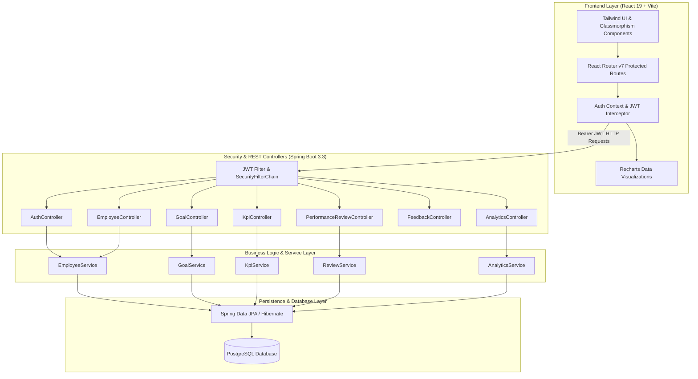

# ⚡ PULSE — Enterprise Employee Performance & Feedback Management System

[](https://spring.io/projects/spring-boot)
[](https://react.dev/)
[](https://vitejs.dev/)
[](https://www.postgresql.org/)
[](https://tailwindcss.com/)
[](LICENSE)

**PULSE** is a full-stack, enterprise-grade Employee Performance, OKR Tracking, Continuous Feedback, and 360° Review platform. Built with a modern **Spring Boot 3 (Java 21)** REST backend and a high-performance **React 19 + Vite** frontend styled with a dark-canvas design system.

---

## 📑 Table of Contents

- [Key Highlights](#-key-highlights)
- [System Architecture](#-system-architecture)
- [Core Features & Modules](#-core-features--modules)
  - [1. Executive Performance Dashboard](#1-executive-performance-dashboard)
  - [2. Employee Directory & Org Hierarchy](#2-employee-directory--org-hierarchy)
  - [3. OKR & Goal Management](#3-okr--goal-management)
  - [4. KPI (Key Performance Indicator) Tracking](#4-kpi-key-performance-indicator-tracking)
  - [5. 360° Continuous Feedback](#5-360-continuous-feedback)
  - [6. Formal Performance Reviews & Cycles](#6-formal-performance-reviews--cycles)
  - [7. Advanced Analytics & Talent Insights](#7-advanced-analytics--talent-insights)
  - [8. Role-Based Access Control (RBAC)](#8-role-based-access-control-rbac)
- [Technology Stack](#-technology-stack)
- [Project Directory Structure](#-project-directory-structure)
- [Getting Started & Installation](#-getting-started--installation)
  - [Prerequisites](#prerequisites)
  - [Backend Setup (Spring Boot)](#backend-setup-spring-boot)
  - [Frontend Setup (React + Vite)](#frontend-setup-react--vite)
- [Default Demo Accounts](#-default-demo-accounts)
- [REST API Endpoints Overview](#-rest-api-endpoints-overview)
- [Security & Authentication](#-security--authentication)
- [License & Authors](#-license--authors)

---

## 🌟 Key Highlights

- **Role-Based Workflows**: Dedicated permissions and views for `ADMIN`, `MANAGER`, and `EMPLOYEE`.
- **Real-Time Analytics & Charts**: Interactive data visualizations powered by Recharts (distribution bell curves, department rankings, goal completion velocity).
- **Continuous 360° Feedback**: Real-time peer recognition, manager coaching, and constructive feedback loops.
- **OKR Progress Tracking**: Quantitative milestones, priority weighting, and real-time completion percentages.
- **Automated Data Seeder**: Pre-configured database initializer (`DataInitializer.java`) with departments, employees, review cycles, KPIs, and demo metrics.
- **Dual-Mode Frontend**: Works with live Spring Boot REST endpoints or automatic mock fallback for standalone demonstrations.

---

## 🏗 System Architecture



---

## 🚀 Core Features & Modules

### 1. Executive Performance Dashboard
- **KPI Summary Cards**: Total active employees, company-wide average rating, goal completion rate, and pending review counts.
- **Interactive Visualizations**: Rating trends over time, department performance breakdowns, and goal completion trajectories.
- **Quick Action Center**: One-click actions to initiate review cycles, assign goals, send peer feedback, or view alerts.
- **Activity & Feedback Feeds**: Real-time stream of latest peer kudos, rating approvals, and milestone completions.

### 2. Employee Directory & Org Hierarchy
- **Comprehensive Profiles**: Employee code, designation, department, manager hierarchy, contact details, joining date, and status (`ACTIVE`, `ON_LEAVE`, `TERMINATED`).
- **Dynamic Search & Filtering**: Filter by department, designation, status, or search by name and email in real-time.
- **Manager-Subordinate Mapping**: View direct reporting lines and manager associations.
- **CRUD Operations**: Modal-based creation and updates for employee records (restricted to Admins & Managers).

### 3. OKR & Goal Management
- **SMART Goal Tracking**: Title, description, key results, target completion date, priority levels (`CRITICAL`, `HIGH`, `MEDIUM`, `LOW`).
- **Progress Tracking**: Dynamic slider/step progress updates (0% to 100%) with status lifecycle (`NOT_STARTED`, `IN_PROGRESS`, `COMPLETED`, `ON_HOLD`).
- **Alignment**: Link individual employee goals to broader departmental initiatives and strategic KPIs.

### 4. KPI (Key Performance Indicator) Tracking
- **Quantitative Metrics**: Defined targets, actual values, measurement units (`%`, `USD`, `Score`, `Count`), and calculation formulas.
- **Departmental KPIs**: Target performance metrics tailored for Engineering, Product, Sales, Marketing, and HR.
- **Achievement Status**: Instant visual status badges (`ON_TRACK`, `AT_RISK`, `BEHIND`, `EXCEEDED`).

### 5. 360° Continuous Feedback
- **Peer Recognition & Coaching**: Send positive praise or constructive feedback to team members.
- **Categorization**: Tag feedback by competencies (e.g., *Collaboration*, *Leadership*, *Technical Excellence*, *Problem Solving*).
- **Privacy & Visibility**: Public kudos or private manager-only feedback channels.

### 6. Formal Performance Reviews & Cycles
- **Periodic Review Cycles**: Setup and manage evaluation cycles (e.g., *Q3 2026 Comprehensive Review*, *Annual Appraisal*).
- **Multi-Rater Appraisals**: Self-evaluations, manager reviews, and peer ratings.
- **Scoring System**: 1.0 to 5.0 weighted rating scale with qualitative feedback on strengths, improvements, and growth plans.
- **Workflow State Machine**: Review statuses from `DRAFT` $\to$ `SUBMITTED` $\to$ `UNDER_REVIEW` $\to$ `APPROVED` $\to$ `COMPLETED`.

### 7. Advanced Analytics & Talent Insights
- **Performance Bell Curve**: Normal distribution curve of employee ratings across the organization.
- **Departmental Comparisons**: Comparative bar charts and radar views across departments.
- **Talent Risk & Flight Risk Detection**: Identifies top performers requiring promotion and employees needing performance improvement plans (PIPs).
- **Historical Trends**: Multi-cycle performance progression and goal completion velocity.

### 8. Role-Based Access Control (RBAC)
| Feature / Page | Admin | Manager | Employee |
| :--- | :---: | :---: | :---: |
| Executive Dashboard | Full Access | Department View | Personal View |
| Employee Directory Management | Create / Edit / Delete | View & Direct Reports | View Only |
| Goal Creation & Tracking | All Employees | Department / Reports | Self Assigned |
| KPI Definition & Editing | Full Access | Department KPIs | View Only |
| Performance Reviews | Approve & Finalize | Submit for Reports | Submit Self-Review |
| Continuous Feedback | Full Access | Full Access | Send & Receive |
| Advanced Analytics | Full Company | Department Level | Restricted |
| System Settings | Full Access | Profile & Preferences | Profile Only |

---

## 🛠 Technology Stack

### Backend
- **Language & Runtime**: Java 21 (LTS)
- **Framework**: Spring Boot 3.3.4
- **Security**: Spring Security 6 with JJWT (`io.jsonwebtoken:jjwt`)
- **Database ORM**: Spring Data JPA & Hibernate
- **Database**: PostgreSQL (Production/Dev)
- **Object Mapping**: MapStruct 1.5.5
- **Validation**: Hibernate Validator (JSR-380)
- **API Documentation**: Springdoc OpenAPI / Swagger UI 2.6.0
- **Build Tool**: Apache Maven

### Frontend
- **Framework**: React 19 (Hooks, Context API, Suspense)
- **Bundler & Dev Server**: Vite 8 with Fast HMR
- **Routing**: React Router DOM v7
- **Styling**: Tailwind CSS v3, PostCSS, Custom Design System Tokens
- **Icons**: Lucide React
- **Data Visualization**: Recharts 3.x
- **HTTP Client**: Axios with automatic request/response interceptors & token refresh
- **Linter**: Oxlint

---

## 📁 Project Directory Structure

```text
College_Intern_Project/
├── backend/                              # Spring Boot Application
│   ├── pom.xml                           # Maven dependencies & build configuration
│   └── src/
│       ├── main/
│       │   ├── java/com/pulse/performance/
│       │   │   ├── config/              # Security, CORS, OpenAPI & DataInitializer
│       │   │   ├── controller/          # REST Controllers (Auth, Emp, Goal, KPI, etc.)
│       │   │   ├── dto/                 # Request & Response Data Transfer Objects
│       │   │   ├── entity/              # JPA Entities (User, Employee, Goal, Review, etc.)
│       │   │   ├── exception/           # Global Exception Handling & Custom Exceptions
│       │   │   ├── mapper/              # MapStruct Entity-DTO Mappers
│       │   │   ├── repository/          # Spring Data JPA Repositories
│       │   │   ├── security/            # JWT Token Provider, Auth EntryPoint & UserDetails
│       │   │   ├── service/             # Business Logic Service Interfaces & Impls
│       │   │   └── PerformanceApplication.java
│       │   └── resources/
│       │       └── application.yml      # DB, JWT, Port, and CORS configuration
│       └── test/                        # Unit & Integration Tests
│
└── pulse-app/                            # React 19 + Vite Frontend
    ├── package.json                      # Frontend dependencies & scripts
    ├── vite.config.js                    # Vite configuration
    ├── tailwind.config.js                # Custom color palettes & UI tokens
    ├── index.html                        # Single Page App HTML Entry
    └── src/
        ├── api/                          # Axios API client modules
        ├── components/                   # Reusable UI components, modals, shell
        │   ├── common/                   # Modal, Card, StatsCard, Table
        │   ├── layout/                   # AppShell, Sidebar, Header, MobileNav
        │   └── ui/                       # Badge, Button, Input, Dropdown
        ├── context/                      # AuthContext & ToastContext
        ├── data/                         # Mock data fallbacks
        ├── pages/                        # View Pages (Dashboard, Employees, Goals, etc.)
        ├── utils/                        # Formatting, date helpers & validators
        ├── App.jsx                       # Route definitions & Role guards
        ├── index.css                     # Design system styles & animations
        └── main.jsx                      # React DOM Entry Point
```

---

## ⚙️ Getting Started & Installation

### Prerequisites
- **JDK 21** or later installed
- **Node.js** v18+ and **npm** v9+ installed
- **PostgreSQL** 14+ installed and running (or use default credentials below)
- **Maven** 3.8+ (or use the included Maven wrapper)

---

### Backend Setup (Spring Boot)

1. **Configure PostgreSQL**:
   Create a database named `college_project`:
   ```sql
   CREATE DATABASE college_project;
   ```

2. **Verify Configuration** in `backend/src/main/resources/application.yml`:
   ```yaml
   spring:
     datasource:
       url: jdbc:postgresql://localhost:5432/college_project
       username: postgres
       password: your_postgres_password
   ```

3. **Build and Run**:
   ```bash
   cd backend
   mvn clean spring-boot:run
   ```
   *The backend starts on `http://localhost:8080`.*
   *Swagger API Documentation is available at `http://localhost:8080/swagger-ui.html`.*

---

### Frontend Setup (React + Vite)

1. **Navigate to the frontend directory**:
   ```bash
   cd pulse-app
   ```

2. **Install Dependencies**:
   ```bash
   npm install
   ```

3. **Start the Development Server**:
   ```bash
   npm run dev
   ```
   *The application will launch on `http://localhost:5173`.*

---

## 🔐 Default Demo Accounts

The database is pre-seeded with sample users for instant evaluation:

| Role | Username | Password | Full Name / Title |
| :--- | :--- | :--- | :--- |
| **Admin** | `admin` | `admin123` | System Administrator (*COO*) |
| **Manager** | `sarah.manager` | `password123` | Sarah Chen (*VP of Engineering*) |
| **Employee** | `alex.dev` | `password123` | Alex Morgan (*Senior Fullstack Engineer*) |
| **Employee** | `marcus.lead` | `password123` | Marcus Vance (*Tech Lead*) |
| **Employee** | `elena.design` | `password123` | Elena Rostova (*Lead Product Designer*) |

> **Tip**: On the login screen (`/login`), you can also use the one-click demo role selector buttons to log in instantly without typing credentials!

---

## 📡 REST API Endpoints Overview

| Method | Endpoint | Description | Access Level |
| :--- | :--- | :--- | :--- |
| `POST` | `/api/auth/login` | Authenticate user and issue JWT token | Public |
| `GET` | `/api/employees` | List all employees (filterable & paginated) | Authenticated |
| `POST` | `/api/employees` | Create a new employee profile | `ADMIN`, `MANAGER` |
| `GET` | `/api/departments` | List all departments and headcount metrics | Authenticated |
| `GET` | `/api/goals` | Retrieve OKRs & goals (user/department) | Authenticated |
| `POST` | `/api/goals` | Create a new goal | `ADMIN`, `MANAGER`, `EMPLOYEE` |
| `PUT` | `/api/goals/{id}/progress` | Update goal milestone progress | Assigned User / Manager |
| `GET` | `/api/kpis` | List all departmental & company KPIs | Authenticated |
| `GET` | `/api/reviews` | List performance review cycles and ratings | Authenticated |
| `POST` | `/api/reviews` | Submit a performance self-evaluation or review | Authenticated |
| `GET` | `/api/feedback` | List peer kudos and continuous feedback | Authenticated |
| `POST` | `/api/feedback` | Post new 360° feedback | Authenticated |
| `GET` | `/api/analytics/summary` | Executive metrics, bell curve & stats | `ADMIN`, `MANAGER` |

---

## 🔒 Security & Authentication

- **Stateless JWT**: Secure tokens signed using HMAC-SHA256 with 24-hour expiration.
- **BCrypt Hashing**: Passwords stored using industry-standard salted BCrypt hashing.
- **CORS Support**: Pre-configured for Vite dev server (`http://localhost:5173`) and React ports.
- **Method-Level Security**: Protected controller routes with `@PreAuthorize("hasRole('ADMIN')")` annotations.

---

## 📄 License

This project is developed as part of an academic / internship capstone project. Distributed under the MIT License.
